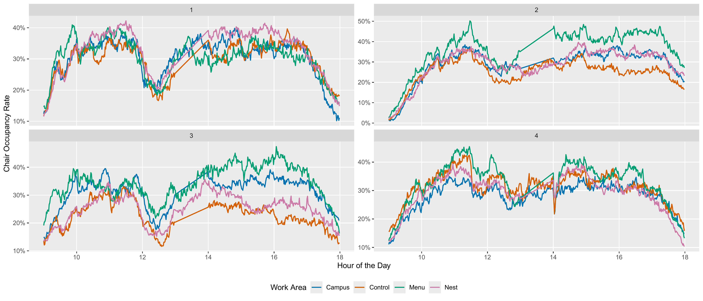
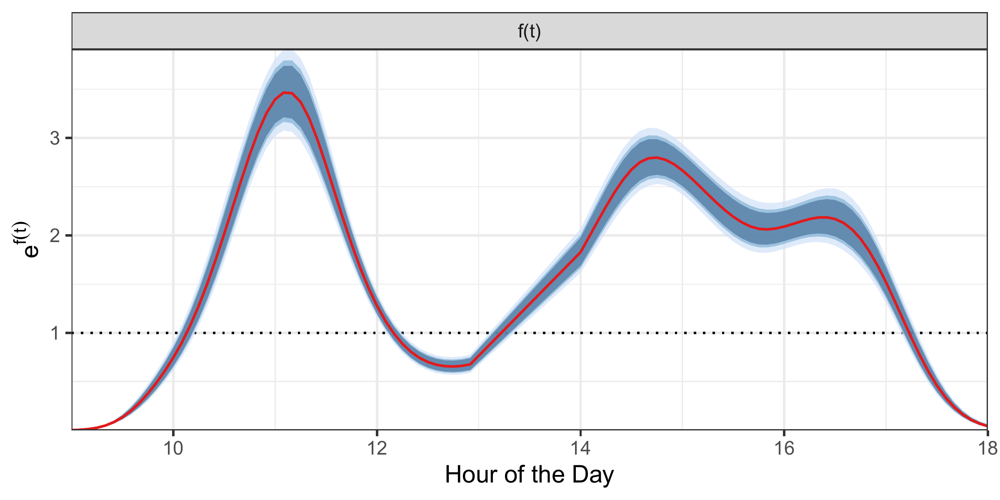
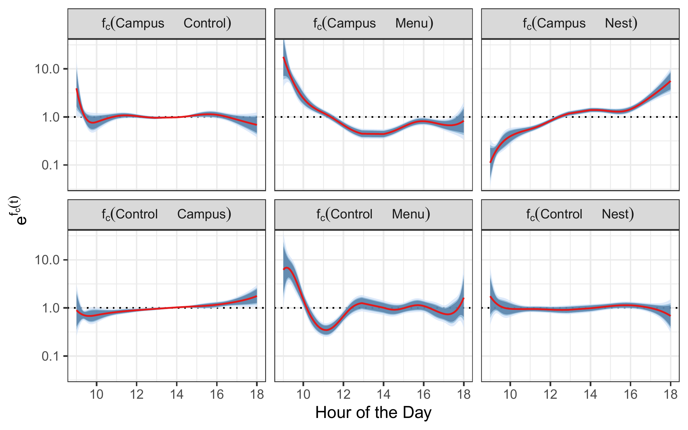
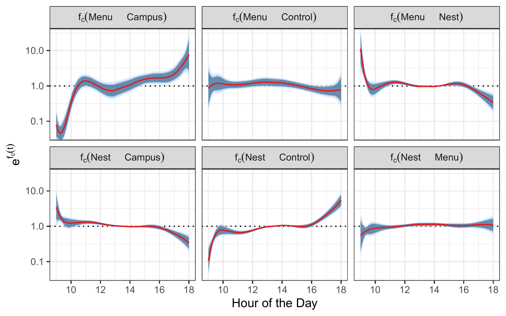
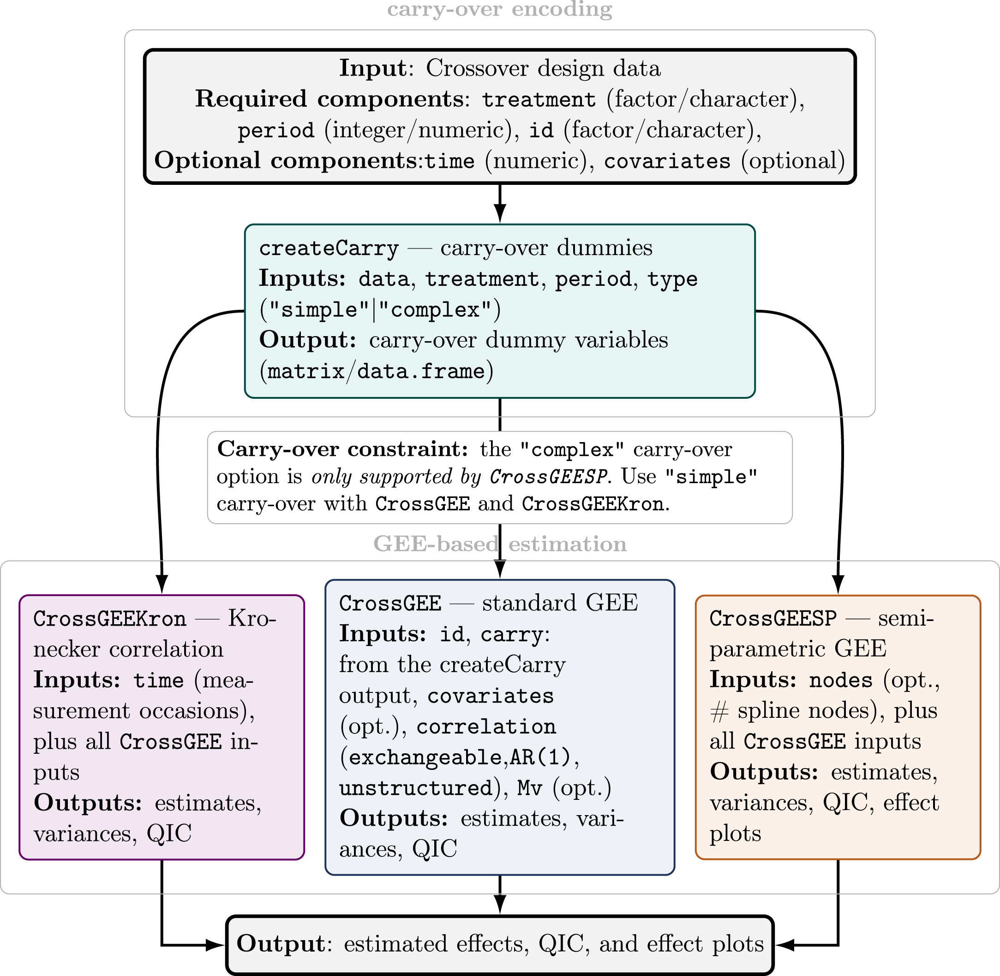

## 

{fig-align="center" width="100%"}

## Ejemplo inicial

<iframe src="https://www.ecoavant.com/contaminacion/alimentar-vacas-con-papel_2595_102.html" width="100%" height="700" style="border:none;">

</iframe>

## Datos iniciales

```{r, echo=FALSE, eval=TRUE}
library(readxl)
Vacas <- read_excel("data/Vacas.xlsx", 
    sheet = "Peso")
library(tidyverse)

ggplot(
  Vacas,
  aes(
    x = factor(periodo),
    y = pesodif,
    group = vaca
  )
) +
  geom_hline(
    yintercept = 0,
    linetype = 2,
    colour = "grey60"
  ) +
  geom_line(
    colour = "grey40",
    linewidth = 0.8,
    alpha = 0.8
  ) +
  geom_point(
    aes(fill = tratamiento),
    shape = 21,
    size = 4.5,
    colour = "black",
    stroke = 0.5
  ) +
  scale_fill_manual(
    values = c(
      control = "#D95F02",
      papel   = "#1B9E77"
    )
  ) +
  labs(
    x = "Periodo",
    y = "Cambio de peso (kg)"
  ) +
  theme_bw(base_size = 16) +
  theme(
    panel.grid.minor = element_blank(),
    panel.grid.major.x = element_blank(),
    panel.border = element_rect(
      colour = "black",
      linewidth = 0.8
    )
  )
```

## Cambio de peso de las vacas

```{r, echo=FALSE, eval=TRUE}
Vacas2 <- Vacas |>
  arrange(vaca, periodo) |>
  group_by(vaca) |>
  mutate(
    secuencia = paste(tratamiento, collapse = "-")
  ) |>
  ungroup()

library(ggplot2)

ggplot(
  Vacas2,
  aes(
    x =periodo,
    y = pesodif,
    group = vaca
  )
) +
  geom_hline(
    yintercept = 0,
    linetype = 2,
    colour = "grey70"
  ) +
  geom_line(
    linewidth = 0.8,
    alpha = 0.6,
    colour = "grey50"
  ) +
  geom_point(
    aes(fill = tratamiento),
    shape = 21,
    size = 4,
    colour = "black"
  ) +
  facet_wrap(
    ~ secuencia,
    nrow = 1,
    labeller = labeller(
      secuencia = c(
        "control-papel" = "Secuencia BA",
        "papel-control" = "Secuencia AB"
      )
    )
  ) +
  scale_fill_manual(
    values = c(
      "control" = "#E64B35",
      "papel"   = "#4DBBD5"
    )
  ) +
  scale_x_continuous(
    breaks = c(1, 2),
    labels = c("Per 1", "Per 2")
  ) +
  labs(
    x = NULL,
    y = "Cambio de peso (kg)",
    fill = "Tratamiento"
  ) +
  theme(
    legend.position = "top",
    panel.grid.minor = element_blank(),
    strip.text = element_text(face = "bold", size = 15)
  )+
  stat_summary(
  aes(group = 1),
  fun = mean,
  geom = "line",
  linewidth = 2,
  linetype = "dashed",
  colour = "black"
) +
stat_summary(
  aes(group = 1),
  fun = mean,
  geom = "point",
  size = 5,
  colour = "black"
)
```

## Componentes de un diseño crossover

::::: columns
::: {.column width="52%"}

### Diseño experimental

| Secuencia | Período 1 | Período 2 |
|:---------:|:---------:|:---------:|
| **AB** | Pasto | Papel |
| **BA** | Papel | Pasto |

<br>

### Unidad experimental

Cada **vaca** recibe ambos tratamientos, pero en diferente orden.

:::

::: {.column width="48%"}

### Elementos del diseño

- **Tratamientos:** pasto y papel
- **Secuencias:** AB y BA
- **Períodos:** 1 y 2
- **Unidades:** vacas

<br>

::: {.callout-warning appearance="simple"}
## Carry-over

El tratamiento del primer período puede seguir actuando durante el segundo.
:::

:::
:::::

## Tipos de efectos de arrastre (*carry-over*)

::::::: columns
:::: {.column width="50%"}
### Carry-over de primer orden

El efecto residual persiste durante el período posterior a la aplicación del tratamiento.

::: callout-note
La respuesta observada en el período $t$ puede estar influenciada por el tratamiento administrado en el período $t-1$.
:::

**Ejemplo**

Parte de la respuesta observada en el segundo período todavía puede reflejar el efecto de la dieta basada en papel.
::::

:::: {.column width="50%"}
### Carry-over de segundo orden

El efecto residual persiste durante dos períodos después de la aplicación del tratamiento.

::: callout-note
La respuesta observada en el período $t$ puede estar influenciada por tratamientos administrados en los períodos $t-1$ y $t-2$.
:::

**Ejemplo**

Con tres períodos, la respuesta observada en el Período 3 puede verse afectada por un tratamiento aplicado en el Período 1.
::::
:::::::

::: callout-important
La identificación y modelización adecuada de los efectos de arrastre es fundamental para obtener estimaciones no sesgadas de los efectos de tratamiento en diseños crossover.
:::

## Tipos de efectos de arrastre (*carry-over*)

::::::: columns
:::: {.column width="50%"}
### Carry-over simple

El efecto residual de un tratamiento es el mismo independientemente del tratamiento que se administre posteriormente.

::: callout-note
El efecto remanente depende únicamente del tratamiento previo.
:::

**Ejemplo**

El efecto residual de **A** es idéntico en: A → B; A → C; - A → D
::::

:::: {.column width="50%"}
### Carry-over complejo

El efecto residual depende tanto del tratamiento previo como del tratamiento posterior.

::: callout-warning
El efecto remanente puede variar según la combinación de tratamientos.
:::

**Ejemplo**

El efecto residual de **A** puede ser distinto en: A → B; A → C; A → D
::::
:::::::

::: callout-important
**Pregunta clave:** ¿el tratamiento A deja siempre la misma "huella" o esta depende del tratamiento que se aplique después?
:::

## Primer paso: respuestas no normales

La literatura sobre diseños crossover se ha concentrado principalmente en **respuestas continuas con distribución normal**.

::: {.callout-tip appearance="simple"}
## El caso clásico

Cuando la respuesta es aproximadamente normal, los efectos de **tratamiento**, **período** y **carry-over** pueden evaluarse mediante un **modelo lineal tipo ANOVA**, teniendo en cuenta la variabilidad entre sujetos.
:::

Sin embargo, muchas aplicaciones producen respuestas que **no son normales**:

- **Conteos**
- **Eventos**
- **Número de éxitos**
- **Respuestas binarias**

::: {.callout-note appearance="simple"}
## Nuestra objetivo

Desarrollar una metodología para diseños crossover con respuestas de la **familia exponencial**, antes de abordar estructuras de diseño más complejas.
:::

## Un escenario inicial sencillo

::::: columns
::: {.column width="52%"}

### Estructura del diseño

- Una observación por **individuo y período**
- Diseños crossover **2 × 2**
- Posibles efectos de **carry-over**
- Mediciones repetidas **correlacionadas**

:::

::: {.column width="48%"}

### Tipo de respuesta

$$
Y_{ij} \sim \text{Familia exponencial}
$$
$$
E(Y_{ij})=\mu_{ij} =g^{-1}(Algo)
$$
<div style="text-align:center;">

**Normal · Binaria · Conteo · Número de éxitos**

</div>

:::
:::::

::: {.callout-warning appearance="simple"}
## El desafío

La respuesta observada puede depender del **tratamiento actual**, de los **tratamientos previos** y de la **correlación entre períodos**.

Ignorar esta estructura puede producir estimaciones distorsionadas de los efectos de tratamiento.
:::

## Dos formas de modelar la dependencia

::::: columns
::: {.column width="50%"}

### GEE: modelo marginal

$$
g(\mu_{ijt})
=
\mathbf{x}_{ijt}^{\mathsf T}\boldsymbol{\beta}, \;
\mu_{ijt}=E(Y_{ijt}\mid \mathbf{x}_{ijt})
$$

y la asociación entre las observaciones del individuo $i$ se modela mediante:

$$
\operatorname{Corr}(\mathbf{Y}_i)
=
\mathbf{R}(\boldsymbol{\alpha})
$$

::: {.callout-note appearance="simple"}
Los coeficientes describen efectos **promedio en la población**.
:::

:::

::: {.column width="50%"}

### GLMM: modelo condicional

$$
g(\mu_{ijt}\mid \mathbf{b}_i)
=
\mathbf{x}_{ijt}^{\mathsf T}\boldsymbol{\beta}
+
\mathbf{z}_{ijt}^{\mathsf T}\mathbf{b}_i
$$

donde

$$
\mu_{ijt}
=
E(Y_{ijt}\mid \mathbf{x}_{ijt},\mathbf{b}_i),
\qquad
\mathbf{b}_i\sim N(\mathbf{0},\mathbf{D})
$$

::: {.callout-note appearance="simple"}
Los coeficientes describen efectos **condicionales o específicos del individuo**.
:::

:::
:::::

::: {.callout-tip appearance="simple"}
## La diferencia fundamental

**GEE:** modela directamente la respuesta promedio y especifica una estructura de correlación.

**GLMM:** explica la dependencia mediante efectos aleatorios asociados a cada individuo.
:::
## ¿Por qué GEE y no GLMM?

::::: columns
::: {.column width="50%"}
### Ventajas de GEE

- Estima efectos promedio poblacionales.

- No requiere asumir una distribución para efectos aleatorios.

- Menor complejidad computacional.

- Inferencia robusta frente a errores en la estructura de correlación.

- Interpretación directa de los efectos marginales.

- Suele presentar mayor estabilidad en muestras pequeñas o moderadas.
:::

::: {.column width="50%"}
### Ventajas de GLMM

- Permite modelar heterogeneidad entre individuos.

- Estima trayectorias específicas por sujeto.

- Maneja diseños desbalanceados de forma natural.

- Puede modelar estructuras jerárquicas complejas.

- Permite realizar predicciones individuales.

- Aprovecha información cuando existen muchas mediciones por sujeto.
:::
:::::


## Limitaciones de cada aproximación

::::: columns
::: {.column width="50%"}
### Desventajas de GEE

- No modela explícitamente la variabilidad individual.

- Las predicciones para sujetos específicos son limitadas.

- La inferencia asintótica puede verse afectada con tamaños muestrales muy pequeños.

- Menos eficiente si la estructura de correlación está muy mal especificada.
:::

::: {.column width="50%"}
### Desventajas de GLMM

- Requiere especificar distribuciones para los efectos aleatorios.

- Mayor complejidad computacional posibles problemas de convergencia.

- Estimaciones inestables cuando el número de sujetos es reducido.

- Interpretación menos directa de los efectos poblacionales.
:::
:::::

::: callout-note
En este trabajo el interés principal era estimar correctamente los efectos de tratamiento, período y *carry-over* a nivel poblacional. Por ello se optó por una aproximación basada en **GEE**, incorporando explícitamente la correlación entre observaciones repetidas dentro de cada individuo.
:::

## Análisis de diseños crossover con respuestas de la familia exponencial

Cruz, N. A., López Pérez, L. A. & Melo, O. O. (2023). *Analysis of cross-over experiments with count data in the presence of carry-over effects*. Statistica Neerlandica, 77(4), 516–542.

::: callout-note
Se desarrolló un marco estadístico para analizar diseños crossover cuando la respuesta no es normal (por ejemplo, conteos Poisson) y pueden existir efectos de arrastre (*carry-over*).
:::

- Incorporación explícita de efectos de tratamiento, período y carry-over.
- Modelización de la correlación entre observaciones del mismo individuo mediante **GEE**.
- Desarrollo de una tabla de análisis análoga al ANOVA y con *correción de muestras pequeñas*.

### Resultado principal

Los estudios de simulación mostraron que ignorar los efectos de arrastre puede producir estimaciones sesgadas del efecto del tratamiento, mientras que la estrategia basada en GEE mantiene inferencias fiables incluso en presencia de carry-over.

## Limitaciones de las herramientas disponibles

Inicialmente se exploró el uso de los paquetes clásicos de R para GEE: `gee` y `geepack`.

::: callout-warning
La teoría desarrollada en nuestro artículo no solo modifica la ecuación de media incorporando efectos *carry-over*, sino que también deduce expresiones específicas para las matrices de covarianza y para la inferencia asociada a dichos efectos.
:::

::::: columns
::: {.column width="50%"}
### Los paquetes disponibles:

- No incorporaban la parametrización específica de los efectos *carry-over*.
- No utilizaban las matrices de varianza deducidas para este tipo de diseños.
:::

::: {.column width="50%"}
### Fue necesario programar:

- Las matrices de diseño para tratamientos, períodos y *carry-over*.
- Los algoritmos de estimación.
- Las matrices robustas de varianza.
:::
:::::

::: callout-important
La complejidad de estas implementaciones motivó posteriormente la creación de un paquete especializado que automatizara todo el flujo de análisis para diseños crossover.
:::

## Nace CrossCarry

{width="85%" fig-align="center"}

## Modelo para el diseño de las vacas

Para la vaca $i$ en el período $j$, consideramos:

$$
g(\mu_{ij})
=
\beta_0
+
\beta_1\,\text{Tratamiento}_{ij}
+
\beta_2\,\text{Período}_{ij}
+
\beta_3\,\text{CarryOver}_{ij},
$$

donde

$$
\mu_{ij}=E(Y_{ij}\mid \mathbf{x}_{ij}).
$$

::::: columns
::: {.column width="50%"}

### Efectos incluidos

- **Tratamiento actual**
- **Período**
- **Carry-over simple**

:::

::: {.column width="50%"}

### Dependencia

Las mediciones de una misma vaca están correlacionadas:

$$
\operatorname{Corr}(\mathbf{Y}_i)
=
\mathbf{R}(\boldsymbol{\alpha}).
$$

:::
:::::

::: {.callout-note appearance="simple"}
## En este ejemplo

$Y_{it}$ representa el **cambio de peso** de la vaca $i$ en el período $t$.

La función `CrossGEE()` estima los efectos promedio poblacionales teniendo en cuenta la correlación entre las observaciones de una misma vaca.
:::

## Uso en un diseño sencillo

```{r, message=FALSE, echo=TRUE, eval=FALSE}
library(CrossCarry)
datosV <- createCarry(Vacas, treatment = "tratamiento", period = "periodo", id = "vaca", carrySimple = TRUE)
modelV <- CrossGEE(response = "pesodif",treatment = "tratamiento", period = "periodo", id = "vaca", carry = datosV$carryover,
                   data=datosV$data, correlation = "unstructured" )
summary(modelV$model)
```

```{r, echo=FALSE, message=FALSE, results='hide'}
library(CrossCarry)
datosV <- createCarry(Vacas, treatment = "tratamiento", period = "periodo", id = "vaca", carrySimple = TRUE)
modelV <- CrossGEE(response = "pesodif",treatment = "tratamiento", period = "periodo", id = "vaca", carry = datosV$carryover, data=datosV$data, correlation = "AR-M" )
summary(modelV$model)
```

```{r, echo=FALSE}
summary(modelV$model)
```

## Correlación dentro de cada vaca

```{r}
library(corrplot)
corrplot(
  modelV$model$working.correlation,
  type = "full",
  diag = FALSE,
  tl.col = "black",
  tl.cex = 0.9,
  cl.cex = 0.8,
  col = colorRampPalette(
    c("#2166AC", "white", "#B2182B")
  )(200)
)


corrplot(
  modelV$model$working.correlation,
  add =TRUE,
  type = "lower",
  method = "number",
  diag = TRUE,
  number.cex = 0.9,
  col = "black"
)
```

## ¿Y la producción de leche?

```{r, eval=TRUE, echo=FALSE}
library(readxl)
Vacas <- read_excel("data/Vacas.xlsx", 
    sheet = "Leche")

Vacas2 <- Vacas |>
  arrange(vaca, periodo) |>
  group_by(vaca) |>
  mutate(
    secuencia = paste(tratamiento, collapse = "-")
  ) |>
  ungroup()
```

```{r}
ggplot(
  Vacas2,
  aes(
    x = tiempo,
    y = Proddif,
    group = vaca
  )
) +
  geom_hline(
    yintercept = 0,
    linetype = 2,
    colour = "grey70"
  ) +
  geom_line(
    linewidth = 0.7,
    alpha = 0.5,
    colour = "grey50"
  ) +
  geom_point(
    aes(fill = tratamiento),
    shape = 21,
    size = 3.5,
    colour = "black"
  ) +
  facet_grid(
    periodo ~ secuencia,
    labeller = labeller(
      secuencia = c(
        "control-control-control-papel-papel-papel" =
          "Secuencia BA",
        "papel-papel-papel-control-control-control" =
          "Secuencia AB"
      ),
      periodo = c(
        "1" = "Periodo 1",
        "2" = "Periodo 2"
      )
    )
  ) +
  scale_fill_manual(
    values = c(
      control = "#E64B35",
      papel   = "#4DBBD5"
    )
  ) +
  scale_x_continuous(
    breaks = c(14, 28, 42),
    labels = c("T1", "T2", "T3")
  ) +
  labs(
    x = NULL,
    y = "Cambio de producción",
    fill = "Tratamiento"
  ) +
  stat_summary(
    aes(group = 1),
    fun = mean,
    geom = "line",
    linewidth = 1.8,
    linetype = "dashed",
    colour = "black"
  ) +
  stat_summary(
    aes(group = 1),
    fun = mean,
    geom = "point",
    size = 4,
    colour = "black"
  ) +
  theme_bw(base_size = 14) +
  theme(
    legend.position = "top",
    panel.grid.minor = element_blank(),
    strip.text.x = element_text(
      size = 11,
      face = "bold"
    ),
    strip.text.y = element_text(
      size = 11,
      face = "bold"
    )
  )

```

## Un modelo más complicado

```{r, message=FALSE, echo=TRUE, eval=FALSE}
datosV <- createCarry(Vacas, treatment = "tratamiento",
                      period = "periodo", id = "vaca", carrySimple = TRUE)
modelV <- CrossGEE(response = "Proddif",treatment = "tratamiento", 
                   period = "periodo", id = "vaca", carry = datosV$carryover,
                   covar = "tiempo", data=datosV$data, correlation = "unstructured" )
summary(modelV$model)
```

```{r, echo=FALSE, message=FALSE, warning=FALSE, results='hide'}
datosV <- createCarry(
      Vacas,
      treatment = "tratamiento",
      period = "periodo",
      id = "vaca",
      carrySimple = TRUE
    )

modelV <- CrossGEE(
  response = "Proddif",
  treatment = "tratamiento",
  period = "periodo",
  id = "vaca",
  carry = datosV$carryover,
  covar = "tiempo",
  data = datosV$data,
  correlation = "unstructured"
)

summary(modelV$model)
```

```{r, echo=FALSE}
summary(modelV$model)
```

## Estructura de correlación

```{r, message=FALSE, echo=TRUE, eval=FALSE}
datosV <- createCarry(Vacas, treatment = "tratamiento",
                      period = "periodo", id = "vaca", carrySimple = TRUE)
modelV <- CrossGEE(response = "Proddif",treatment = "tratamiento", 
                   period = "periodo", id = "vaca", carry = datosV$carryover,
                   covar = "tiempo", data=datosV$data, correlation = "AR-M" )
summary(modelV$model)
```

```{r, echo=FALSE, message=FALSE, results='hide'}
datosV <- createCarry(Vacas, treatment = "tratamiento",
                      period = "periodo", id = "vaca", carrySimple = TRUE)
modelV <- CrossGEE(response = "Proddif",treatment = "tratamiento", 
                   period = "periodo", id = "vaca", carry = datosV$carryover,
                   covar = "tiempo", data=datosV$data, correlation = "AR-M" )
summary(modelV$model)
```

```{r, echo=FALSE}
summary(modelV$model)
```

## Correlación dentro de cada vaca

```{r}
corrplot(
  modelV$model$working.correlation,
  type = "full",
  diag = FALSE,
  tl.col = "black",
  tl.cex = 0.9,
  cl.cex = 0.8,
  col = colorRampPalette(
    c("#2166AC", "white", "#B2182B")
  )(200)
)


corrplot(
  modelV$model$working.correlation,
  type = "lower",
  add =TRUE,
  method = "number",
  diag = TRUE,
  number.cex = 0.9,
  col = "black"
)
```

## Diseños crossover con medidas repetidas

Las observaciones presentan varios niveles de dependencia:

- Mediciones tomadas sobre el mismo individuo: Observaciones cercanas en el tiempo.
- Dependencia inducida por los tratamientos previamente administrados.

::: callout-warning
Las estructuras clásicas de correlación (independence, exchangeable, AR(1) o unstructured) asumen un único patrón de dependencia para todos los datos.
:::

::::: columns
::: {.column width="50%"}
### Estructuras estándar

- Fáciles de implementar.
- Disponibles en software general.
- Pueden subestimar o sobreestimar la correlación entre observaciones.
:::

::: {.column width="50%"}
### Estructura Kronecker

- Diferencia correlaciones dentro y entre períodos.
- Considera la secuencia de tratamientos.
- Admite medidas repetidas dentro de cada período.
:::
:::::

## Matrices de correlación Kronecker

$$
\mathbf{R}
=
\mathbf{R}_{P}
\otimes
\mathbf{R}_{T}
=
\begin{bmatrix}
1 & \rho_P \\
\rho_P & 1
\end{bmatrix}
\otimes
\begin{bmatrix}
1 & \rho_T & \rho_T^2 \\
\rho_T & 1 & \rho_T \\
\rho_T^2 & \rho_T & 1
\end{bmatrix}
$$

donde: $\mathbf{R}_{P}$: correlación entre períodos del diseño crossover. $\mathbf{R}_{T}$: correlación temporal entre mediciones repetidas dentro de cada período y $\otimes$ es el producto Kronecker.

::: callout-note
Esta formulación permite separar simultáneamente la dependencia longitudinal de corto plazo y la dependencia generada por la estructura crossover.
:::

::: callout-important
La adaptación de esta estructura a diseños crossover y el desarrollo de sus resultados teóricos fueron presentados en:

**Cruz, Melo & Martínez (2024)**\
*A correlation structure for the analysis of Gaussian and non-Gaussian responses in crossover experimental designs with repeated measures*. *Statistical Papers*, 65, 263–290.
:::

## Correlación de Kronecker

```{r, echo=TRUE, message=FALSE,results='hide'}
datosV <- createCarry(Vacas, treatment = "tratamiento",
                      period = "periodo", id = "vaca", carrySimple = TRUE)
modelV <- CrossGEEKron(response = "Proddif",treatment = "tratamiento", 
                   period = "periodo", id = "vaca", carry = datosV$carryover,
                   time = "tiempo", covar = "tiempo", data=datosV$data, 
                   correlation = "AR-M" )
summary(modelV$model)
```

```{r, echo=FALSE}
summary(modelV$model)
```


## Correlación de Kronecker

```{r, echo=TRUE, message=FALSE,results='hide'}
Vacas <- Vacas |> mutate(tiempo2 = tiempo^2)
datosV <- createCarry(Vacas, treatment = "tratamiento",
                      period = "periodo", id = "vaca", carrySimple = TRUE)
modelV <- CrossGEEKron(response = "Proddif",treatment = "tratamiento", 
                   period = "periodo", id = "vaca", carry = datosV$carryover,
                   time = c("tiempo", "tiempo2"), covar = "tiempo", data=datosV$data, 
                   correlation = "AR-M" )
summary(modelV$model)
```

```{r, echo=FALSE}
summary(modelV$model)
```
## Correlación entre periodos

```{r}
corrplot(
  modelV$Between,
  type = "full",
  diag = FALSE,
  tl.col = "black",
  tl.cex = 0.9,
  cl.cex = 0.8,
  col = colorRampPalette(
    c("#2166AC", "white", "#B2182B")
  )(200)
)


corrplot(
  modelV$Between,
  type = "lower",
  add =TRUE,
  method = "number",
  diag = TRUE,
  number.cex = 0.9,
  col = "black"
)
```

## Correlación dentro de periodos

```{r}
corrplot(
  modelV$Within,
  type = "full",
  diag = FALSE,
  tl.col = "black",
  tl.cex = 0.9,
  cl.cex = 0.8,
  col = colorRampPalette(
    c("#2166AC", "white", "#B2182B")
  )(200)
)


corrplot(
  modelV$Within,
  type = "lower",
  add =TRUE,
  method = "number",
  diag = TRUE,
  number.cex = 0.9,
  col = "black"
)
```

## Correlación de Kronecker

```{r}
corrplot(
  kronecker(modelV$Between, modelV$Within),
  type = "full",
  diag = FALSE,
  tl.col = "black",
  tl.cex = 0.9,
  cl.cex = 0.8,
  col = colorRampPalette(
    c("#2166AC", "white", "#B2182B")
  )(200)
)


corrplot(
  kronecker(modelV$Between, modelV$Within),
  type = "lower",
  add =TRUE,
  method = "number",
  diag = TRUE,
  number.cex = 0.9,
  col = "black"
)
```

## Experimento de presión arterial

Los datos provienen de un estudio crossover con tres tratamientos antihipertensivos y medidas repetidas de presión arterial realizadas dentro de cada período experimental.

### Diseño

| Secuencia | Período 1   | Período 2   | Período 3   |
|-----------|-------------|-------------|-------------|
| ABC       | $Y_{11}(t)$ | $Y_{12}(t)$ | $Y_{13}(t)$ |
| ACB       | $Y_{21}(t)$ | $Y_{22}(t)$ | $Y_{23}(t)$ |
| BAC       | $Y_{31}(t)$ | $Y_{32}(t)$ | $Y_{33}(t)$ |
| BCA       | $Y_{41}(t)$ | $Y_{42}(t)$ | $Y_{43}(t)$ |
| CAB       | $Y_{51}(t)$ | $Y_{52}(t)$ | $Y_{53}(t)$ |
| CBA       | $Y_{61}(t)$ | $Y_{62}(t)$ | $Y_{63}(t)$ |

::: callout-warning
Dentro de cada periodo se están observando 10 mediciones de cada unidad experimental.
:::

## 

```{r}
Arterial2 <- Arterial |>
  arrange(Subject, Period) |>
  group_by(Subject) |>
  mutate(
    Sequence = paste(
      Treatment[Period == 1][1],
      Treatment[Period == 2][1],
      Treatment[Period == 3][1],
      sep = ""
    )
  ) |>
  ungroup()

ggplot(
  Arterial2,
  aes(
    x = Time,
    y = Pressure,
    group = Subject,
    colour = factor(Treatment)
  )
) +
  geom_line(
    alpha = 0.35,
    linewidth = 0.8
  ) +
  stat_summary(
  aes(
    group = interaction(Period, Treatment),
    colour = factor(Treatment)
  ),
  fun = mean,
  geom = "line",
  linewidth = 2
) +
stat_summary(
  aes(
    group = interaction(Period, Treatment),
    colour = factor(Treatment)
  ),
  fun = mean,
  geom = "point",
  size = 3
) +
  facet_grid(
    Period ~ Sequence
  ) +
  scale_colour_manual(
    values = c(
      "#E64B35",
      "#4DBBD5",
      "#00A087"
    ),
    name = "Tratamiento"
  ) +
  labs(
    x = "Tiempo",
    y = "Presión"
  ) +
  theme_bw(base_size = 12) +
  theme(
    legend.position = "top",
    strip.text.x = element_text(
      face = "bold",
      size = 12
    ),
    strip.text.y = element_text(
      face = "bold",
      size = 12
    ),
    panel.grid.minor = element_blank()
  )
```

## ¿Por qué modelar el tiempo de forma no paramétrica?

:::::: columns
:::: {.column width="55%"}
La evolución temporal puede presentar:

- Descensos rápidos después de administrar el tratamiento.
- Estabilización en mediciones posteriores.
- Curvaturas, mesetas o cambios de pendiente.
- Perfiles temporales diferentes entre tratamientos.

::: callout-warning
Incluir el tiempo únicamente como un término lineal $\beta_t\,t,$ obliga a que la presión cambie a una tasa constante, lo cual puede no representar adecuadamente la respuesta observada.
:::
::::

::: {.column width="45%"}
### Modelo semiparamétrico

En lugar de imponer una forma específica, se incorpora una función suave del tiempo:

$$
g\{\mu_{ijkt}\}
=
\mathbf{x}_{ijk}^{\mathsf T}\boldsymbol{\beta}
+
f(t),
$$

donde:

- $\mathbf{x}_{ijk}^{\mathsf T}\boldsymbol{\beta}$ contiene los efectos de tratamiento, período y *carry-over*.
- $f(t)$ representa la trayectoria temporal estimada directamente a partir de los datos.
:::
::::::

## Modelo GEE semiparamétrico para diseños crossover

Se desarrolló una extensión GEE, diseñada para analizar respuestas con medidas repetidas dentro de cada período.

::::: columns
::: {.column width="50%"}
### Componentes del modelo

- **Componente paramétrico** para estimar: Efectos de tratamiento, Efectos de período, Otras covariables de interés.

- **Componente no paramétrico** basado en *splines* para modelar: La evolución temporal de la respuesta.
:::

::: {.column width="50%"}
### Propiedades encontradas

$$
\sqrt{n}
\left(
\widehat{\boldsymbol{\beta}}-\boldsymbol{\beta}
\right)
\overset{d}{\longrightarrow}
N\left(
\mathbf{0},
\mathbf{A}^{-1}\mathbf{B}\mathbf{A}^{-1}
\right).
$$

Estimación flexible de las funciones temporales mediante bases de *splines*
:::
:::::

::: callout-important
La adaptación de esta estructura a diseños crossover y el desarrollo de sus resultados teóricos fueron presentados en:

**Cruz, Melo & Martínez (2023)**\
*Semiparametric generalized estimating equations for repeated measurements in cross-over designs*. *Statistical Methods in Medical Research*, **32**(5), 1033–1050.
:::

## Estructura del modelo GEE semiparamétrico

Para la unidad experimental $i$, en el período $j$ y en el tiempo $t$:

$$
g\!\left(\mu_{ijt}\right)
=
\underbrace{
\beta_0
+
\boldsymbol{x}_{ij}^{\mathsf T}\boldsymbol{\beta}
}_{\text{componente paramétrico}}
+
\underbrace{
f(t)
}_{\text{componente no paramétrico}},\; 
\mu_{ijt}
=
E\!\left(Y_{ijt}\mid \boldsymbol{x}_{ij},t\right).
$$

::::: columns
::: {.column width="50%"}

### Componente paramétrico

El vector $\boldsymbol{x}_{ij}$ puede incluir:

- Efecto de **tratamiento**
- Efecto de **período**
- Otras covariables

Los coeficientes $\boldsymbol{\beta}$ representan efectos promedio en la población.

:::

::: {.column width="50%"}

### Componente no paramétrico

La función temporal se aproxima mediante una base de *splines*:

$$
f(t)
=
\sum_{k=1}^{K}
\gamma_k B_k(t).
$$
La función $f(t)$ representa el comportamiento basal temporal de la respuesta. 

:::
:::::


## Un modelo con carry-over simple

```{r, echo=TRUE, message=FALSE,results='hide'}
data(Arterial)
carrydata <- createCarry(data=Arterial, treatment = "Treatment",
                         period = "Period",id="Subject", carrySimple = TRUE)
modelA <- CrossGEESP(response = "Pressure", treatment = "Treatment",
                    period = "Period", id="Subject", time="Time",
                    carry=carrydata$carryover,data=carrydata$data,
                    correlation = "AR-M")
```

```{r, echo=FALSE}
summary(modelA$model)
```


## Estimación de la función temporal $f(t)$

```{r, echo=FALSE, message=FALSE, warning=FALSE}
plot_f <- modelA$graph[[1]] +
  ggplot2::labs(
    x = "Tiempo (minutos)",
    y = "Cambio en la presión arterial sistólica"
  ) +
  ggplot2::theme_bw(base_size = 18) +
  ggplot2::theme(
    plot.title = ggplot2::element_blank(),
    axis.title = ggplot2::element_text(
      face = "bold",
      size = 12
    ),
    axis.text = ggplot2::element_text(
      size = 12,
      colour = "black"
    ),
    panel.grid.minor = ggplot2::element_blank(),
    panel.grid.major = ggplot2::element_line(
      colour = "grey90",
      linewidth = 0.4
    ),
    panel.border = ggplot2::element_rect(
      colour = "grey30",
      linewidth = 0.8
    ),
    plot.margin = ggplot2::margin(10, 20, 10, 10)
  )

plot_f
```

## Efecto *carry-over* de B

```{r, echo=FALSE, message=FALSE, warning=FALSE}
plot_CsobreB <- modelA$graph[[2]] +
  ggplot2::labs(
    x = "Tiempo (minutos)",
    y = "Efecto sobre la presión arterial sistólica"
  ) +
  ggplot2::theme_bw(base_size = 18) +
  ggplot2::theme(
    plot.title = ggplot2::element_blank(),
    axis.title = ggplot2::element_text(
      face = "bold",
      size = 12
    ),
    axis.text = ggplot2::element_text(
      size = 12,
      colour = "black"
    ),
    panel.grid.minor = ggplot2::element_blank(),
    panel.grid.major = ggplot2::element_line(
      colour = "grey90",
      linewidth = 0.4
    ),
    panel.border = ggplot2::element_rect(
      colour = "grey30",
      linewidth = 0.8
    ),
    plot.margin = ggplot2::margin(10, 20, 10, 10)
  )

plot_CsobreB
```
## Efecto *carry-over* de C

```{r, echo=FALSE, message=FALSE, warning=FALSE}
plot_CsobreB <- modelA$graph[[3]] +
  ggplot2::labs(
    x = "Tiempo (minutos)",
    y = "Efecto sobre la presión arterial sistólica"
  ) +
  ggplot2::theme_bw(base_size = 18) +
  ggplot2::theme(
    plot.title = ggplot2::element_blank(),
    axis.title = ggplot2::element_text(
      face = "bold",
      size = 12
    ),
    axis.text = ggplot2::element_text(
      size = 12,
      colour = "black"
    ),
    panel.grid.minor = ggplot2::element_blank(),
    panel.grid.major = ggplot2::element_line(
      colour = "grey90",
      linewidth = 0.4
    ),
    panel.border = ggplot2::element_rect(
      colour = "grey30",
      linewidth = 0.8
    ),
    plot.margin = ggplot2::margin(10, 20, 10, 10)
  )

plot_CsobreB
```

## Un giro inesperado en la investigación

La incorporación de efectos *carry-over* complejos surgió en la etapa final de la tesis, a partir de una observación realizada durante la revisión del artículo.

::: callout-warning
Uno de los revisores señaló que asumir efectos *carry-over* simples podía ser poco realista en estudios farmacológicos, porque el efecto residual de un tratamiento no necesariamente es igual sobre todos los tratamientos posteriores.
:::

Sin embargo, también existía una dificultad importante:

- El número de efectos aumentaba considerablemente.
- Con tres tratamientos se debían estimar seis transiciones distintas.
- Se esperaba que la falta de grados de libertad produjera problemas de identificabilidad o convergencia.
- Inicialmente, no estaba claro que el modelo pudiera estimarse con muestras pequeñas.

## ¿Qué se logró?

::: callout-note
En ese momento conseguimos implementar los efectos *carry-over* complejos y el algoritmo logró converger con los datos reales.
:::

Sin embargo, una solución computacional no garantizaba todavía que el método tuviera un buen comportamiento estadístico.

::::: columns
::: {.column width="50%"}
### Las incógnitas

- ¿Había suficientes grados de libertad?
- ¿El modelo estaba sobreparametrizado?
- ¿La convergencia se mantendría en otros escenarios?
- ¿Las seis funciones podían estimarse de forma estable?
:::

::: {.column width="50%"}
### Lo que encontramos

- El algoritmo logró converger.
- Las funciones de *carry-over* pudieron estimarse.
- El procedimiento mostró estabilidad en simulación.
- El desempeño mejoró al aumentar las mediciones por período.
:::
:::::

::: callout-important
La implementación resolvió el problema inmediato, pero fue el estudio de simulación el que permitió comprobar que no se trataba únicamente de una convergencia afortunada: el modelo podía estimar efectos *carry-over* complejos y dependientes del tiempo con un buen comportamiento numérico.
:::


## Un modelo con carry-over complejo

```{r, echo=TRUE, message=FALSE,results='hide'}
data(Arterial)
carrydata <- createCarry(data=Arterial, treatment = "Treatment",
                         period = "Period",id="Subject", carrySimple = FALSE)
modelB <- CrossGEESP(response = "Pressure", treatment = "Treatment",
                    period = "Period", id="Subject", time="Time",
                    carry=carrydata$carryover,data=carrydata$data,
                    correlation = "AR-M")
```

```{r, echo=FALSE}
summary(modelB$model)
```

## Estimación de la función temporal $f(t)$

```{r, echo=FALSE, message=FALSE, warning=FALSE}
plot_f <- modelB$graph[[1]] +
  ggplot2::labs(
    x = "Tiempo (minutos)",
    y = "Cambio en la presión arterial sistólica"
  ) +
  ggplot2::theme_bw(base_size = 18) +
  ggplot2::theme(
    plot.title = ggplot2::element_blank(),
    axis.title = ggplot2::element_text(
      face = "bold",
      size = 12
    ),
    axis.text = ggplot2::element_text(
      size = 12,
      colour = "black"
    ),
    panel.grid.minor = ggplot2::element_blank(),
    panel.grid.major = ggplot2::element_line(
      colour = "grey90",
      linewidth = 0.4
    ),
    panel.border = ggplot2::element_rect(
      colour = "grey30",
      linewidth = 0.8
    ),
    plot.margin = ggplot2::margin(10, 20, 10, 10)
  )

plot_f
```

## Carry-over complejo y dependiente del tiempo

En este modelo, el efecto residual depende de dos elementos: El tratamiento administrado en el período anterior y El tratamiento recibido en el período actual. Por tanto, cada transición entre tratamientos tiene su propia función de *carry-over*:

:::::: columns
::: {.column width="50%"}
### Efectos desde A y B

- $f_{A\rightarrow B}(t)$: efecto residual de A sobre B.
- $f_{A\rightarrow C}(t)$: efecto residual de A sobre C.
- $f_{B\rightarrow A}(t)$: efecto residual de B sobre A.
- $f_{B\rightarrow C}(t)$: efecto residual de B sobre C.
:::

:::: {.column width="50%"}
### Efectos desde C

- $f_{C\rightarrow A}(t)$: efecto residual de C sobre A.
- $f_{C\rightarrow B}(t)$: efecto residual de C sobre B.

::: callout-warning
$$
f_{A\rightarrow B}(t)
\neq
f_{B\rightarrow A}(t)\neq f_{B\rightarrow C}(t)
$$
:::
::::
::::::

::: callout-important
No existe una única “huella” residual para cada tratamiento. La forma y magnitud del *carry-over* dependen de la transición específica y pueden cambiar a lo largo del tiempo.
:::

## Efecto *carry-over* de C sobre B

```{r, echo=FALSE, message=FALSE, warning=FALSE}
plot_CsobreB <- modelB$graph[[7]] +
  ggplot2::labs(
    x = "Tiempo (minutos)",
    y = "Efecto sobre la presión arterial sistólica"
  ) +
  ggplot2::theme_bw(base_size = 18) +
  ggplot2::theme(
    plot.title = ggplot2::element_blank(),
    axis.title = ggplot2::element_text(
      face = "bold",
      size = 12
    ),
    axis.text = ggplot2::element_text(
      size = 12,
      colour = "black"
    ),
    panel.grid.minor = ggplot2::element_blank(),
    panel.grid.major = ggplot2::element_line(
      colour = "grey90",
      linewidth = 0.4
    ),
    panel.border = ggplot2::element_rect(
      colour = "grey30",
      linewidth = 0.8
    ),
    plot.margin = ggplot2::margin(10, 20, 10, 10)
  )

plot_CsobreB
```
## 

```{r, echo=FALSE, message=FALSE, warning=FALSE}
library(ggplot2)
library(patchwork)

titulos_carry <- c(
  "Carry-over de A sobre B",
  "Carry-over de A sobre C",
  "Carry-over de B sobre A",
  "Carry-over de B sobre C",
  "Carry-over de C sobre A",
  "Carry-over de C sobre B"
)

plots_carry <- Map(
  function(grafica, titulo) {
    grafica +
      labs(
        title = titulo,
        x = "Tiempo (minutos)",
        y = "Efecto"
      ) +
      theme_bw(base_size = 14) +
      theme(
        plot.title = element_text(
          face = "bold",
          size = 14,
          hjust = 0.5,
          margin = margin(b = 8)
        ),
        axis.title = element_text(
          face = "bold",
          size = 11
        ),
        axis.text = element_text(
          size = 10,
          colour = "black"
        ),
        panel.grid.minor = element_blank(),
        panel.grid.major = element_line(
          colour = "grey90",
          linewidth = 0.4
        ),
        panel.border = element_rect(
          colour = "grey30",
          linewidth = 0.8
        ),
        plot.margin = margin(8, 8, 8, 8)
      )
  },
  modelB$graph[2:7],
  titulos_carry
)

wrap_plots(plots_carry, ncol = 3, nrow = 2) +
  plot_annotation(
    title = "Efectos carry-over estimados",
    theme = theme(
      plot.title = element_text(
        face = "bold",
        size = 20,
        hjust = 0.5
      )
    )
  )
```

## Selección del modelo: QIC y CIC

- **QIC:** compara el ajuste global de los modelos GEE.
- **CIC:** compara principalmente las estructuras de correlación.
- En ambos criterios, **valores menores indican una mejor alternativa**.

::: {.callout-note appearance="simple"}
El número de parámetros reportado corresponde únicamente a los coeficientes $\boldsymbol{\beta}$.

Los parámetros asociados con las funciones suaves no se muestran en `params`, pero su complejidad se incorpora mediante la **penalización del QIC**.
:::

### Resultado

```{r}
comparacion_QIC <- data.frame(
  Metrica = rownames(modelA$QIC),
  `Modelo carry-over simple` = modelA$QIC[, 1],
  `Modelo carry-over complejo` = modelB$QIC[, 1],
  row.names = NULL,
  check.names = FALSE
)

comparacion_QIC
```

## Un marco que reúne todo el desarrollo

::: callout-important
La adaptación de esta estructura a diseños crossover y el desarrollo de sus resultados teóricos fueron presentados en:

**Cruz, Melo & Mylona (2026)**\
*Penalized GEE for Complex Carry-Over in Repeated-Measures Crossover Designs*. *Statistical *Statistics in Medicine*, **45**(10–12), e70561.
:::
::::: columns
::: {.column width="50%"}
### Fundamentos metodológicos

- **GEE** para considerar la correlación entre observaciones del mismo individuo.

- **Modelo semiparamétrico** para separar: Efectos de tratamiento y período, Evolución temporal de la respuesta, Efectos *carry-over* variables en el tiempo.

- **Carry-over complejo** específico para cada transición: $f_{g\rightarrow g'}(t).$
:::

::: {.column width="50%"}
### Nuevos desarrollos

- Condiciones formales de **identificabilidad y estimabilidad**.

- Contracción de efectos residuales débiles hacia cero.

- Selección de la penalización mediante: QIC, Validación cruzada, Validación cruzada generalizada.
:::
:::::

::: callout-important
El nuevo marco reúne **GEE, modelización semiparamétrica, efectos carry-over complejos, bases funcionales y penalización** en una metodología general para diseños crossover con medidas repetidas.
:::

## Aplicación: experimento en espacios de trabajo

El estudio evaluó cómo diferentes configuraciones de oficina afectaban la ocupación de los puestos de trabajo.

::::: columns
::: {.column width="50%"}
### Diseño experimental

- **288 participantes**, organizados en 22 equipos de trabajo.
- Cuatro grupos de aproximadamente 72 participantes.
- Diseño crossover de Williams:
  - 4 tratamientos.
  - 4 períodos.
  - 4 secuencias.
- Cada período tuvo una duración de **dos semanas**.
- Todos los grupos estuvieron expuestos a las cuatro configuraciones, pero en diferente orden.
:::

::: {.column width="50%"}
### Configuraciones evaluadas

- **Control:** oficina abierta convencional.
- **Nest:** espacios de equipo más cerrados.
- **Menu:** oficina basada en actividades.
- **Campus:** oficina abierta dividida en zonas.

### Variable respuesta

La ocupación de las sillas se registró mediante sensores infrarrojos y se resumió en intervalos de cinco minutos $L=96$ mediciones repetidas por participante y período.
:::
:::::

## Secuencias del diseño

| Grupo | Período 1 | Período 2 | Período 3 | Período 4 |
|:-----:|:---------:|:---------:|:---------:|:---------:|
|   1   |  Control  |   Nest    |  Campus   |   Menu    |
|   2   |   Menu    |  Campus   |   Nest    |  Control  |
|   3   |  Campus   |  Control  |   Menu    |   Nest    |
|   4   |   Nest    |   Menu    |  Control  |  Campus   |

::: callout-important
El diseño garantiza que cada configuración aparezca una vez en cada período y que todas las transiciones dirigidas entre tratamientos estén representadas.
:::

::: callout-note
Con cuatro tratamientos existen $4(4-1)=12$ efectos *carry-over* complejos posibles. Las 96 mediciones dentro de cada período proporcionan la información temporal necesaria para estimar sus respectivas funciones.
:::

##

{fig-align="center" width="100%"}


## Modelo para la ocupación

La probabilidad de respuesta se modeló mediante:

$$
\operatorname{logit}(p_{ijk})
=
\log\left(\frac{p_{ijk}}{1-p_{ijk}}\right)
=
\underbrace{\mathbf{x}_{ijk}^{\top}\boldsymbol{\beta}}_{\text{Efectos paramétricos}}
+
\underbrace{f(Z_{ijk})}_{\text{Tendencia temporal}}
+
\underbrace{\sum_{c=1}^{12} f_c(Z_{ijk})}_{\text{Carry-over complejo}}.
$$

::::: columns
::: {.column width="48%"}

### Componentes del modelo

- $p_{ijk}$: probabilidad de respuesta.
- $\mathbf{x}_{ijk}^{\top}\boldsymbol{\beta}$: efectos de **tratamiento** y **período**.
- $f(Z_{ijk})$: tendencia temporal común.
- $f_c(Z_{ijk})$: efecto residual asociado con la transición $c$.

:::

::: {.column width="52%"}

### Carry-over dependiente del tiempo

Los efectos $f_c$ permiten que el impacto de un tratamiento previo:

- Cambie a lo largo del tiempo.
- Dependa del tratamiento posterior.
- Sea diferente para cada transición.
- Se estime mediante **splines penalizados**.

:::
:::::

##

{fig-align="center" width="100%"}

##

{fig-align="center" width="100%"}

##

{fig-align="center" width="100%"}


## ¿Y por qué estoy hoy en la UNAM?

Esta historia comenzó cuando un investigador de la **UNAM**, que en ese momento se encontraba en **El Salvador**, utilizó `CrossCarry` para analizar un experimento crossover con vacas similar al nuestro.

Pero surgió un problema inesperado:

::: callout-warning
En sus datos, las vacas no estaban identificadas con números.

**¡Tenían nombres!** 🐄
:::

```{r}
nombres_vacas <- c(
  "Palmera", "Brisa", "Appa", "Miranda", "Arrecha",
  "Perlita", "Certeza", "Capilla", "Zira", "Burbuja",
  "Macarena", "Oluga", "Boda", "Avianca", "Obrera",
  "Pinta", "Rumania", "Pepita", "Dina", "Turca",
  "Púrpura", "Marina", "Mansa", "Cremina", "Gata",
  "Cuaresma", "Café", "Galanota", "Malabar", "Orca",
  "Nucita", "Ligia", "Yara", "Directa", "Gaby"
)
options(width = 120)

print(nombres_vacas)
```

El paquete asumía identificadores numéricos y no podía procesar correctamente esa estructura.

::: callout-note
`CrossCarry` funcionaba con los datos para los que había sido desarrollado, pero necesitaba ser más flexible para responder a otras aplicaciones reales.
:::
## 

{fig-align="center" width="100%"}

## De un problema técnico a dos colaboraciones

Lo que comenzó con una dificultad para procesar los identificadores de las vacas terminó convirtiéndose en una colaboración científica.

::: callout-note
`CrossCarry` permitió acompañar el análisis estadístico de dos experimentos crossover realizados con vacas lecheras en condiciones tropicales.
:::

### Publicaciones resultantes

Corea, et al., *Cruz, N. A.*, et al. *Ángeles-Hernandez, J. C*. (2026).\
*Citrus pulp as an alternative energy source for high-yielding dairy cows in tropical systems: Effects on intake, digestibility, nitrogen balance, and dairy performance*.
*Animals*, **16**(5), 806. <https://doi.org/10.3390/ani16050806>

Corea, et al., *Cruz, N. A.*, et al. *Ángeles-Hernandez, J. C*. (2026).\
*Effects of partial substitution of corn (Zea mays) silage with napier grass (Pennisetum purpureum) silage on nutrient use and performance of dairy cows in the tropics*. 
*Italian Journal of Animal Science*, **24**(1), 2334–2345.
<https://doi.org/10.1080/1828051X.2025.2578317>

::: callout-important
La mejora de una herramienta estadística no terminó únicamente en una nueva versión del paquete: abrió la puerta a nuevas preguntas, aplicaciones reales y colaboraciones científicas.
:::

## CrossCarry: de la metodología al software

::::: columns
::: {.column width="55%"}
### ¿Qué reúne el paquete?

- Modelos basados en **GEE**.
- Efectos de tratamiento y período.
- Efectos *carry-over* simples y complejos.
- Modelos semiparamétricos mediante *splines*.
- Medidas repetidas dentro de cada período.
- Estructuras de correlación estándar y de Kronecker.
- Herramientas para crear variables de *carry-over*.
- Criterios para comparar modelos.
:::

::: {.column width="45%"}
### Una herramienta reproducible

- Disponible como paquete de R.
- Documentación completa de las funciones.
- Ejemplos y conjuntos de datos.
- Código abierto.
- Validación de las entradas.
- Mensajes de error más informativos.
- Menor cantidad de código para el usuario.

``` r
install.packages("CrossCarry")
library(CrossCarry)
```
:::
:::::

## CrossCarry: de la metodología al software

::: callout-important
`CrossCarry` transforma varios años de investigación estadística en una herramienta que otros investigadores pueden utilizar, verificar y extender.
:::

### Publicación del software

Cruz, N. A., Melo, O. O., Martinez, C. A., & Alberich, R. (2026).\
*CrossCarry: An R package for the analysis of data from a crossover design with GEE*.\
*SoftwareX*, **33**, 102482.\
https://doi.org/10.1016/j.softx.2025.102482

## 

{fig-align="center" width="100%"}


## La investigación continúa

### Próximos desarrollos

- Modelos **bayesianos**
- Líneas base **dinámicas**
- Nuevos métodos de selección, diagnóstico y predicción

<br>

<div style="text-align:center; font-size:1.25em; font-weight:bold;">

Del análisis de diseños sencillos a una plataforma flexible  
para nuevos desafíos en estudios crossover.

</div>

<br>

<div style="text-align:center; font-size:2.5em; font-weight:bold; color:#2C7FB8;">

¡Gracias!

</div>

<div style="text-align:center; font-size:1.05em;">

**Nelson Alirio Cruz**  
`CrossCarry`

</div>

